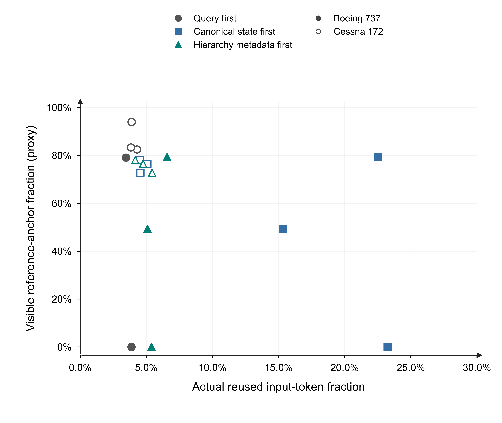

# IntentRAG

IntentRAG studies evidence selection, multi-granularity evidence states, and constrained state reuse for aviation-maintenance question answering. The repository is a research release: it separates retrieval support, generated-output mechanics, documentary-state recurrence, and measured GPU input-KV reuse instead of collapsing them into one accuracy claim.

> Status: private research preview. Source manuals, model weights, raw prompts, full model responses, and text-bearing query-level records are not distributed.

## Research questions

1. Which retrieved observations provide admissible support for the current maintenance query?
2. When can persistent Section/Profile memory complement, but not replace, identity-preserving Detail/Page evidence?
3. How much computational prefix reuse can be gained without removing the local documentary support needed by the answer?

## Main empirical results

| Endpoint | Result | Boundary |
|---|---:|---|
| Retrieval matrix | 33 methods × 690 records = 22,770 cells | Complete method-record matrix |
| Fresh accepted evidence Hit@10 | True BM25 0.972; balanced IntentRAG 0.949 | 214 source-derived questions |
| Multi-granularity neural comparison | IntentRAG multi + CE@50 0.930; matched dense + CE@50 0.827 | Same cross-encoder family |
| Complete required-quote support | True BM25 0.916; balanced IntentRAG 0.902 | Evidence coverage, not answer correctness |
| Long-term/profile-only retrieval | 0.248 / 0.019 accepted Hit@10 | Compressed persistent views cannot replace local evidence |
| Actual input-KV reuse | query-first 0.039; canonical state-first 0.125 | 594 profiles; six independent query pairs |
| Reference-anchor visibility | 0.721 → 0.593 under canonical state-first | Input-support proxy, not admissibility or semantic accuracy |

The fresh set is strongly imbalanced: 212 Cessna questions and two Boeing questions. It is not an aircraft-balanced estimate.



## Repository contents

```text
data/                 public metadata only
docs/                 data, experiment, model and release documentation
experiments/          expanded and legacy research scripts
figures/              independent English result figures
paper/                current manuscript working source and audits
paper_assets/         Sepia/Nature figure source package for Figures 14–27
results/              aggregate tables and figure source data
tools/                release verification utilities
```

`PUBLICATION_MANIFEST.csv` records the provenance and SHA-256 of every staged asset. `PUBLICATION_AUDIT.json` records the pre-publication path/secret/size scan. `SHA256SUMS.txt` covers the repository payload.

## Quick verification

Python 3.10 or newer is recommended.

```bash
python tools/verify_public_release.py
```

This command verifies the method count, fresh-test sample size, key retrieval values, measured KV summaries, failed semantic-judge status, figure availability, and release-document structure. It does not rerun retrieval from the restricted manuals.

See [Reproducibility](docs/REPRODUCIBILITY.md) for the distinction between figure regeneration, aggregate-result verification, full retrieval reruns, and GPU reruns.

## Data policy

Only low-risk metadata, aggregate results, plot source tables, figures, scripts, and audits are tracked. The following are intentionally excluded:

- original aviation-maintenance manuals and long source excerpts;
- raw prompts, complete model answers and judge payloads;
- query-level evidence packages that may reconstruct source text;
- embeddings, vector indexes and model weights;
- local logs, credentials and personal paths.

See [Data Card](docs/DATA_CARD.md) and [Data Release Policy](docs/DATA_RELEASE_POLICY.md).

## Important limitations

- The attempted local 7B semantic audit returned zero valid judgments because the Windows socket was blocked. No semantic answer-accuracy claim is made.
- Parser success and quote matching are mechanical diagnostics, not expert-certified maintenance correctness.
- The signed-prefix and evidence-compatibility fields are operational proxies; they are not independent maintenance authorization.
- The actual KV experiment measures reused input tokens in one runtime configuration. It does not by itself demonstrate throughput gains, evidence validity, or safe cross-revision reuse.

## Release assets

The GitHub release contains a sanitized reproducibility archive, the manuscript working source, and checksums. The larger internal package containing text-bearing raw responses remains withheld from GitHub.

## Citation

Use the metadata in [`CITATION.cff`](CITATION.cff). No DOI is claimed at this stage.

## License

This private review release is currently all rights reserved. No open-source or data redistribution license is granted until code ownership, co-author approval, and derived-data rights have been confirmed.

